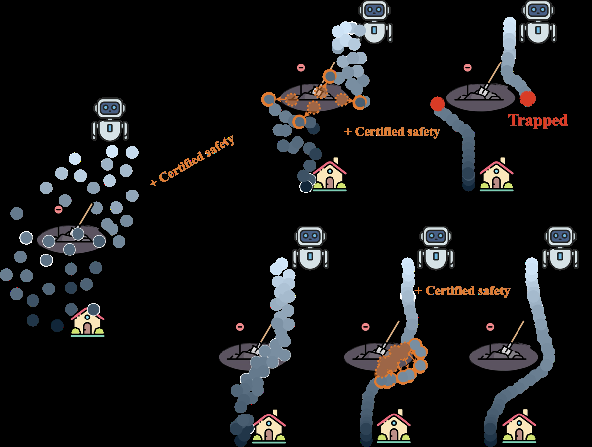
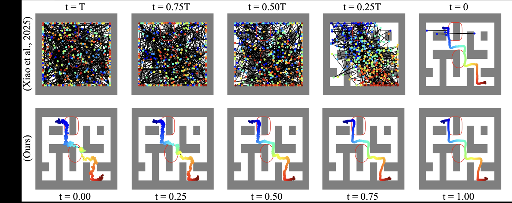
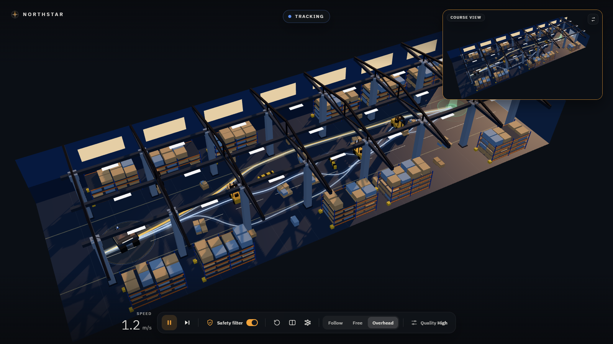
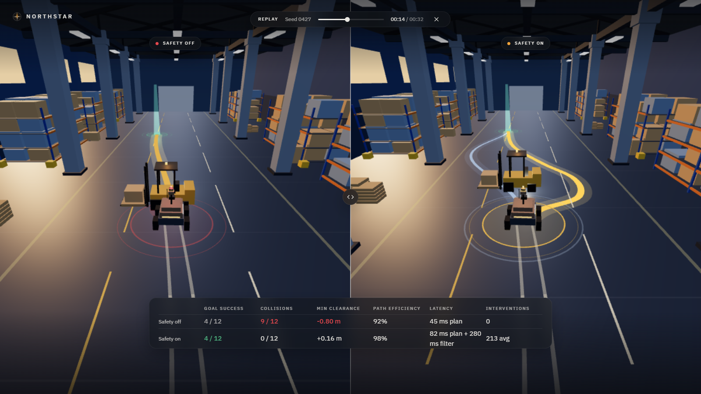
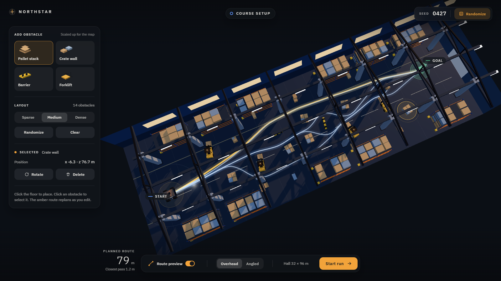

# Northstar

Northstar is a 3D simulation of a small autonomous **ground rover** sharing an industrial hall with
aisles, pallets, and other traffic. The rover proposes a timed path, picks one, and follows it
without colliding. The backend handles physics and collisions, and a React Three Fiber frontend
only draws the frames it is given.

The motion comes from a **conditional flow-matching** network trained from scratch in PyTorch.
Given the rover's pose, nearby obstacles, and a goal, the network turns noise into several
candidate paths, and ranking picks the best of them. Those paths are not automatically safe. A
**control barrier function (CBF)** is a check that the next command would keep the rover out of
an unsafe region, so Northstar filters acceleration and steering before they are applied, and
falls back to an emergency stop if no safe command exists. The vehicle is a simple car-like model
(kinematic bicycle) with speed and steer limits.

Hybrid A* is the classical baseline and the logged fallback, and it is never presented as the
learned result.

## Research direction

Generative models can draw several plausible motions from one scene, which is useful when a warehouse aisle has more than one way around a pallet or a moving forklift. [Flow matching](https://arxiv.org/abs/2210.02747) (Lipman et al., ICLR 2023) does that by learning a velocity field from noise to data, so a short ODE produces a sample instead of a long denoising chain. [FlowMP](https://arxiv.org/abs/2503.06135) (Nguyen et al., IROS 2025) showed the same idea can be a motion-planning prior for robots, including acceleration-aware trajectories.

Those samples are not automatically safe. A flow-matching planner has no built-in collision certificate. [Control barrier functions](https://arxiv.org/abs/1903.07823) (Ames et al.) are the usual tool for that: a quadratic program nudges a command just enough to keep a barrier positive. [SafeFlowMatcher](https://arxiv.org/abs/2509.24243) (Yang, Jang, and Han, ICLR 2026) is the paper that puts the two together. They generate a path with flow matching, then correct it with a CBF quadratic program, and they prove a barrier certificate. The figures below are theirs.

<p align="center">
  
</p>
<p align="center"><em>Overview from Yang, Jang, and Han, SafeFlowMatcher (ICLR 2026). Constraining every intermediate sample during generation can trap a path. Their method generates first, then certifies. Reused under <a href="https://creativecommons.org/licenses/by/4.0/">CC BY 4.0</a> from the <a href="https://takahashi-seiryu.github.io/SafeFlowMatcher/">project page</a>. Resized only. See <a href="docs/assets/ATTRIBUTION.md">ATTRIBUTION.md</a>.</em></p>

<p align="center">
  
</p>
<p align="center"><em>Path generation in Maze2D, same source. Top: a diffusion safety method starts from noise everywhere and can trap. Bottom: SafeFlowMatcher predicts near the target path, then corrects. Reused under CC BY 4.0.</em></p>

Northstar takes that pairing into an industrial ground rover. A self-trained conditional flow-matching net proposes timed bicycle windows. Best-of-eight ranking picks a polyline. A discrete-time CBF-style filter then acts on the executed command `(accel, steer)`, not on the flow that produced the path. Hybrid A* remains the expert and the logged fallback. We do not implement SafeFlowMatcher's prediction-correction integrator and we do not inherit their certificate. IEEE holds the copyright on FlowMP figures, so none are reproduced here.

<p align="center">
  
</p>
<p align="center"><em>The Northstar frontend during a run: the rover tracks a selected trajectory in <code>industrial_facility_v1</code>, with the safety filter on.</em></p>

## State of the project

The full pipeline runs end to end: **model proposes → ranking selects → CBF filter certifies →
bicycle plant integrates → frames reach the frontend**. Flow-matching training converges.

The model alone is **not drivable**. A single candidate collides 47-61% of the time. The system
is usable because best-of-8 ranking plus the safety filter cover it, which is the architecture's
point. Numbers below come from measured runs; method and caveats are in
[`docs/ML_SESSION_STATE.md`](docs/ML_SESSION_STATE.md) and [`docs/CBF_SAFETY.md`](docs/CBF_SAFETY.md).

### Closed loop, 12 held-out v2 scenarios

| | Safety off | Safety on |
|---|---|---|
| Collided | 9 / 12 | **0 / 12** |
| Worst min clearance | −0.80 m | +0.16 m |
| Goal reached | 4 / 12 | 4 / 12 |
| Path efficiency (arrivals only) | 0.92 | 0.98 |
| Fallback replans | 67% | 50% |
| Plan latency | 45 ms | 82 ms |
| CBF solve | n/a | 280 ms |

The filter removes every collision without costing a goal arrival. Fallback rate is *lower* with
the filter on, because it keeps the rover in states the planner can still solve from. Goal arrival
at 4/12 is a planner limitation, not a safety cost.

<p align="center">
  
</p>
<p align="center"><em>Replay view in the app: the same course with the filter off (left) and on (right). The table is the closed-loop measurement above.</em></p>

### Best-of-8 candidate availability

| | v1 test | v2 test |
|---|---|---|
| Windows with ≥1 collision-free candidate | 69.3% | 86.0% |
| Mean clean candidates per window | 3.11 / 8 | 4.25 / 8 |
| Best clean candidate goal progress | 10.93 m | 10.18 m |
| Expert goal progress | 10.31 m | 9.82 m |

The whole difference between a single sample and a usable plan is the ranking step.

### Open-loop quality, 150 windows per arm

| Metric | static_control | primary_dynamic | dropout | Expert |
|---|---|---|---|---|
| Heading error mean, v2 | **24.73°** | 26.82° | 31.30° | 2.65° |
| Collision rate, v2 | 0.468 | 0.487 | 0.493 | 0.000 |
| Latency per candidate | **3.8 ms** | 8.0 ms | 8.5 ms | n/a |

`v2_static_control.pt` is the current best checkpoint and the default in `backend/api/server.py`.
Dynamic conditioning measured as a null twice; static matches or beats it at half the latency.

## Quick start

```bash
python -m venv .venv
.\.venv\Scripts\activate          # Windows
pip install -r requirements.txt
pip install -e .

python -m pytest tests/ -q
```

`.venv` has shipped before with torch and nothing else. If anything reports a missing module,
install `requirements.txt` into the interpreter you are actually using before debugging further.

### Run the demo

```bash
# bridge: /ws, /health, /scenarios, /replays, /facility, /metrics
python -m uvicorn backend.api.server:app --port 8000

cd frontend && npm install && npm run dev      # http://localhost:5173
```

Without `?live=1` the frontend uses canned state, so the demo runs with no backend. Add `?live=1`
to stream real frames. Prefer the **replay** path (`start_replay` intent) for a demo: the live
path is real but streams ~2.8× slower than real time (280 ms CBF solve against a 100 ms control
interval on CPU). `?demo` skips the intro card and the backend check.

<p align="center">
  
</p>
<p align="center"><em>Course setup in the app. Place pallets, barriers, and forklifts; the amber route is a preview, not the learned plan.</em></p>

### Train and evaluate

```bash
python -m backend.ml.train --combined --no-include-oracle \
    --heading-weight 2.0 --speed-weight 0.3 --unit-weight 0.3 \
    --out backend/artifacts/<name>.pt

python -m backend.ml.evaluation backend/artifacts/v2_static_control.pt --windows 150 --steps 16
python -m backend.ml.bridge                 # record frame logs to backend/artifacts/frames/
python scripts/eval_cbf_safety.py           # CBF scenario sweep -> docs/cbf_eval/
```

Training is CPU-first (the team has AMD iGPUs), about 35 s/epoch, early stopping at patience 25.

### Regenerate the dataset

```bash
python scripts/smoke_test.py
python scripts/generate_dataset.py --out data/dataset_v1 --n-scenarios 360 --min-windows 5000
python scripts/validate_dataset.py --root data/dataset_v1
```

Both corpora are already built and validated.

## Dataset

Combined **1,663 scenarios / 22,464 windows**, horizon H=32 at dt=0.2 s. Zero scenario overlap
across all six splits, verified pairwise. Splits are by scenario, never by individual window.

| | v1 | v2_additions |
|---|---|---|
| Scenarios | 363 | 1,300 |
| Windows | 5,021 | 17,443 |
| Train windows | 4,203 | 13,722 |
| `oracle_dynamics=1` | 23.7% | 3.6% |
| Steps over the bicycle curvature limit | 21.6% test / 25.1% train | 0.0% |

Two things to know before training on this:

- **v1 contains kinematically impossible expert trajectories.** One turns 67° while travelling
  0.112 m, where 3.9° is the bicycle maximum. A quarter of v1 training targets contain such a
  step; v2 is clean. This is the leading suspect for the remaining heading error.
- **`subgoal` is a label leak** in both corpora, and `is_local` is never set so it cannot be used
  to filter. `subgoal` stays out of conditioning, and two regression tests enforce that.

Every scenario uses `industrial_facility_v1`. Held-out splits measure unseen obstacle
configurations and routes **inside one building**, not a new building.

## Repository layout

```
CLAUDE.md                  Shared team guide (conventions, ownership, ground rules)
Handoff.md                 Full design brief, including message schemas (section 10)
facilities/                Authoritative base facility JSON (shared with the frontend)
data/dataset_v1/           v1 corpus (5,021 windows)
data/dataset_v2_additions/ v2 corpus (17,443 windows)
northstar/                 Core package: facility, vehicle, planner, dataset, control
backend/ml/                Flow matching: model, train, inference, evaluation, bridge, interactive
backend/api/server.py      FastAPI + WebSocket bridge to the frontend
backend/artifacts/         Checkpoints, frame logs, sample cache (gitignored)
frontend/                  React + TypeScript + React Three Fiber app
scripts/                   Dataset generation, validation, auditing, CBF evaluation
tests/                     pytest suite across data, model, control, API, bridge
docs/                      Data pipeline, CBF safety, training handoff, session state
```

### `northstar/` package

| Module | Role |
|--------|------|
| `facility/` | Versioned facility schema, JSON I/O, occupancy grids, base builder |
| `vehicle/` | Configurable kinematic bicycle model |
| `obstacles/` | Procedural static obstacles + time-indexed dynamic agents |
| `planner/` | Hybrid A*, timed follow, smoother, time-aware search |
| `scenario/` | Procedural scenarios inside the persistent facility |
| `trajectory/` | Full routes + fixed-horizon (H=32, dt=0.2 s) windows |
| `dataset/` | PyTorch `Dataset` + collate helper |
| `control/` | CBF filter, QP, clearance geometry, tracker, closed-loop sim |
| `pipeline/` | Generate / validate orchestration |
| `coords.py` | The single dataset ↔ backend ↔ Three.js conversion |
| `geometry.py`, `collision.py` | Shared geometry and collision checks |

### `backend/ml/`

| Module | Role |
|--------|------|
| `model.py` | Flow-matching net: 7-feature target, 16-feature condition, 256 wide / 3 blocks |
| `dataset.py` | Combined train dataset (refuses val/test by design) + feature construction |
| `train.py` | Flow matching plus physical auxiliary losses |
| `inference.py` | `plan()` → `rank_candidates()` → `best_candidate()` |
| `evaluation.py` | Open-loop physical-quality metrics against the expert |
| `bridge.py` | Closed-loop episodes emitted as schema-1 `StateFrame`s |
| `interactive.py` | The session the frontend drives: destination, dropped obstacles, forklifts |
| `hall.py` | Occupancy for the hall the frontend already draws |

## Model

`STEP_FEATURES = 7`: `x, y, sin(yaw), cos(yaw), speed, steering, accel`. The last two are the
control targets the CBF corrects rather than re-derives.

`COND_FEATURES = 16`: goal (4) + ego speed/steering + **sin/cos of world ego yaw** (4) + vehicle
limits (8). That ego-yaw pair matters: rasters are world-axis-aligned while trajectories are
rover-frame, and without it the model cannot align the map to the path it predicts. Adding it,
plus 3.9× more data, cut mean heading error 42.9° → 22.8°.

1,057,232 params static, 1,156,096 with dynamic conditioning. Reducing capacity is measured as
harmful. The smaller models underfit, and `--hidden-dim` never touches the condition encoder,
which is a fixed ~348k floor.

## Safety filter

The decision variable is `u = (accel, steer_cmd)`. Clearance on the bicycle has **relative degree
2**, so a plain `distance < threshold → brake` is not a CBF. That is only the emergency fallback.
The filter certifies a command by rolling the discrete plant forward through the commitment step,
a 0.7 s preview, a maximum-braking backup, and a 1.5 s idle hold so a predicted moving obstacle
can sweep the stopping point. No formal guarantee is claimed.

Scenario sweep, same pure-pursuit tracker both ways:

| Scenario | Collisions off / on | Min body clearance off / on (m) | Mean solve |
|---|---:|---:|---:|
| static barrier | 11 / **0** | −0.800 / 0.387 | 20.4 ms |
| crossing forklift | 15 / **0** | −0.800 / 0.211 | 21.8 ms |
| narrow corridor | 66 / **0** | −0.080 / 0.170 | 117 ms |
| follow lead | 25 / **0** | −0.800 / 0.371 | 51.1 ms |
| unavoidable wall | 15 / 21 | −0.500 / −0.500 | 34.0 ms |
| open floor | 0 / 0 | none | 0.02 ms |

The unavoidable wall is already inside the braking distance on arrival; both runs collide and the
filter does not claim otherwise. It reduces impact speed from 2.4 to 1.9 m/s. Full assumptions
and limits are in [`docs/CBF_SAFETY.md`](docs/CBF_SAFETY.md).

## Coordinates

Three frames, one conversion point each:

- **Dataset / planning**: horizontal X/Z, elevation Y, yaw about +Y. Fixed by the corpus on disk.
- **Backend** (CLAUDE.md): `(x, y, z)` with z up, heading `psi` in the XY plane.
- **Three.js**: Y-up, `(x, y, z)_backend → (x, z, −y)_frontend`.

`northstar/coords.py` is the only place these map, and `frontend/src/scene/coords.ts` is its
frontend counterpart; both are tested. Convert at the boundary only. Scene components work in
Three.js coordinates and never re-derive the mapping.

## Expert planner (the baseline)

1. Hybrid A* (bicycle primitives) on static geometry
2. B-spline smooth + curvature-aware speed profile
3. Timed following with brake/wait against **predicted** dynamics
4. Validation against **ground-truth** dynamic trajectories

Oracle scenarios are flagged and excluded from training by default; NN `dynamic_occ` uses
constant-velocity predictions. Full detail: [`docs/DATA_PIPELINE.md`](docs/DATA_PIPELINE.md).

## PyTorch loading

```python
from torch.utils.data import DataLoader
from northstar.dataset import NorthstarTrajectoryDataset, collate_trajectory_batch

ds = NorthstarTrajectoryDataset("data/dataset_v1", split="train")
loader = DataLoader(ds, batch_size=16, shuffle=True, collate_fn=collate_trajectory_batch)
```

## Measurement traps worth inheriting

Six of these cost real time; the full write-ups are in
[`docs/ML_SESSION_STATE.md`](docs/ML_SESSION_STATE.md).

1. **Single-seed comparisons are uninterpretable.** Seed 0 said dynamic conditioning hurt, seed 1
   said it helped, three seeds gave a definitive null. Minimum 3 seeds.
2. **Binary metrics saturate.** `heading_consistent` read 0.000 across three arms while mean
   heading error fell 42.3° → 27.0°. Always read the continuous companion.
3. **Per-sample vs batch-mean ramps.** The auxiliary ramp was one batch scalar while the comment
   claimed per-sample fade-in; fixing it moved heading error 35.9° → 27.0°.
4. **Chord-vs-arc curvature.** Measuring yaw change against the chord overestimates by
   `1 + θ²/24`, enough to fail 61% of v2 expert trajectories, which drive at full steering lock.
   Curvature at near-zero speed is also undefined, so mask the gate to moving steps.
5. **Ranking must not reject on the model's raw kinematics.** Only the position polyline reaches
   the plant; rejecting on speed, steering and curvature drove the fallback rate from 24% to 76%.
   Collisions reject, the envelope sorts.
6. **Flow loss and physical quality disagree.** Never rank checkpoints on loss alone.

## References

1. Y. Lipman, R. T. Q. Chen, H. Ben-Hamu, M. Nickel, and M. Le, "Flow Matching for Generative Modeling," ICLR 2023. https://arxiv.org/abs/2210.02747
2. K. Nguyen, A. T. Le, T. Pham, M. Huber, J. Peters, and M. N. Vu, "FlowMP: Learning Motion Fields for Robot Planning with Conditional Flow Matching," IROS 2025. https://arxiv.org/abs/2503.06135
3. J. Yang, S. Jang, and S. Han, "SafeFlowMatcher: Safe and Fast Planning using Flow Matching with Control Barrier Functions," ICLR 2026. https://arxiv.org/abs/2509.24243
4. A. D. Ames, S. Coogan, M. Egerstedt, G. Notomista, K. Sreenath, and P. Tabuada, "Control Barrier Functions: Theory and Applications," ECC 2019. https://arxiv.org/abs/1903.07823
